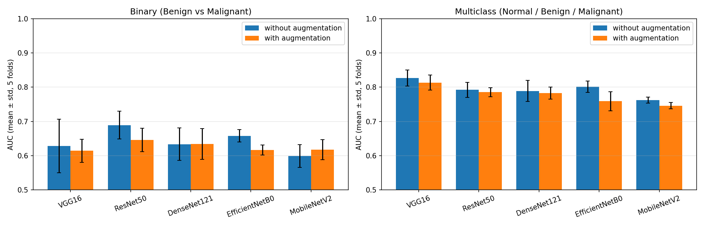
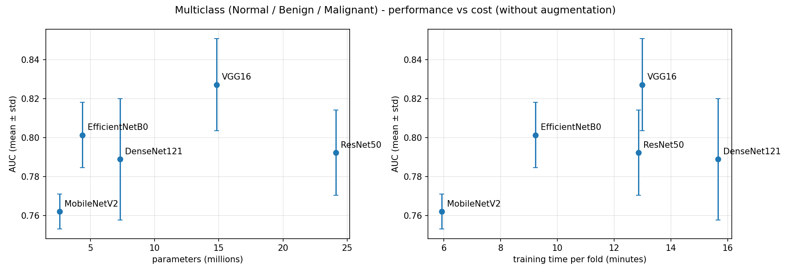

# Comparing 5 pretrained CNNs for whole-mammogram classification

Whole-mammogram classification with five ImageNet-pretrained CNNs (VGG16, ResNet50, DenseNet121,
EfficientNet-B0, MobileNetV2), evaluated with **patient-level 5-fold cross-validation**, with and
without data augmentation. 100 trainings in total, about 21 GPU hours on Kaggle (2× Tesla T4).

Project done as part of a Deep Learning course (Faculté Polydisciplinaire de Khouribga,
Université Sultan Moulay Slimane, Morocco).

## Tasks

| Task | Classes | Images |
|---|---|---|
| Binary | Benign / Malignant | 1,710 |
| Multiclass | Normal / Benign / Malignant | 2,204 (494 / 812 / 898) |

## Data

Three public datasets were merged into **2,204 images from 1,091 patients**:

| Dataset | Type | Label source |
|---|---|---|
| [MIAS](http://peipa.essex.ac.uk/info/mias.html) | Scanned film (PGM) | `severity` column (N / B / M) |
| INbreast (Moreira et al., *Academic Radiology*, 2012) | Digital (DICOM) | BI-RADS: 1–2 Normal, 3 Benign, 4–6 Malignant |
| [CBIS-DDSM](https://www.cancerimagingarchive.net/collection/cbis-ddsm/) | Scanned film, mass cases | Biopsy-confirmed `pathology` |

**The images are not included in this repository** (dataset licenses and patient privacy).
Download them from the original sources.

Preprocessing, the same for all three datasets: breast mask, orientation (all breasts on the left),
crop, histogram equalization inside the breast, padding to a square, 448×448 export
(384×384 for training), and grayscale copied into 3 channels. Duplicate rows (one row per lesion
in CBIS-DDSM and MIAS) were merged so that one image = one sample.

## Method

- **No data leakage:** `StratifiedGroupKFold` (5 folds) grouped by **patient** and stratified by
  dataset × class. Inside the training folds, 20% of the patients form the validation set.
  On INbreast, a classic image-level split put 96% of the test images in a patient already seen in
  training. The patient-level split gives 0%.
- **Transfer learning in 2 phases:** frozen backbone (5 epochs, Adam, lr 1e-3), then full
  fine-tuning (15 epochs, lr 5e-5).
- **Head:** GlobalAveragePooling → Dropout(0.3) → Dense(256, ReLU, L2 1e-4) → Dropout(0.3) → softmax.
- **Training details:** balanced class weights, gradient clipping (clipnorm = 1.0), early stopping on
  validation AUC (patience 8, best weights restored), mixed precision, 2-GPU `MirroredStrategy`.
- **Binary threshold:** chosen on the validation set with Youden's index.
- **Augmentation (training only):** rotation ±5°, zoom 10%, translation 10%, contrast 10%.

## Results

Mean ± standard deviation over the 5 test folds, without augmentation.

| Model | Params | Binary AUC | Multiclass AUC |
|---|---|---|---|
| VGG16 | 14.8 M | 0.628 ± 0.078 | **0.827 ± 0.024** |
| ResNet50 | 24.1 M | **0.689 ± 0.041** | 0.792 ± 0.022 |
| DenseNet121 | 7.3 M | 0.633 ± 0.048 | 0.789 ± 0.031 |
| EfficientNet-B0 | 4.4 M | 0.658 ± 0.018 | 0.801 ± 0.017 |
| MobileNetV2 | 2.6 M | 0.599 ± 0.033 | 0.762 ± 0.009 |



## Key findings

1. **Benign vs malignant is the hard part.** Normal images are recognized 86–91% of the time,
   but benign and malignant are often confused (≈ 60% correct for VGG16). This is why the
   multiclass AUC is higher than the binary AUC.
2. **A dataset shortcut exists.** All Normal images come from MIAS and INbreast. A model can learn
   "CBIS style → not Normal". To measure this, we computed the AUC **inside each dataset**:
   VGG16 stays well above chance (0.68–0.80), but MobileNetV2 drops to ≈ 0.51 inside INbreast and
   MIAS, so it relies mostly on the shortcut.
3. **Augmentation did not clearly help.** The AUC was lower in 8 of 10 cases, but most
   differences are smaller than the fold-to-fold standard deviation.
4. **Recommended model: EfficientNet-B0.** It does not have the best mean AUC, but it is the
   most stable in the binary task, the only model above 0.6 AUC inside every dataset in binary,
   has the best sensitivity, and is small and fast.



## Limitations

- Moderate performance on benign vs malignant (best AUC 0.69). This is a study, not a clinical tool.
- Small datasets for INbreast and MIAS, so per-dataset results are less precise.
- No external test set. Mixed precision on 2 GPUs is not fully deterministic.
- Ideas for improvement: higher resolution or lesion patches, normal images from the full DDSM
  to remove the shortcut, and evaluation on an external dataset.

## Repository structure

```
notebooks/
  1_data_preparation.ipynb          merge + clean the 3 datasets (CPU)
  2_training_binary.ipynb           5 CNNs × 5 folds, binary task (GPU)
  2_training_binary_fold4_fix.ipynb re-run of 8 failed fold-4 trainings (drop_remainder=True)
  2_training_multiclass.ipynb       5 CNNs × 5 folds, multiclass task (GPU)
  3_results.ipynb                   tables, confusion matrices, curves, cost (CPU)
figures/                            result charts
```

The notebooks were run on Kaggle (TensorFlow 2.20). Order: 1 → 2 → 3. They read their inputs
from `/kaggle/input/`, so update the paths if you run them elsewhere.

## Author

Mohamed Baounna
